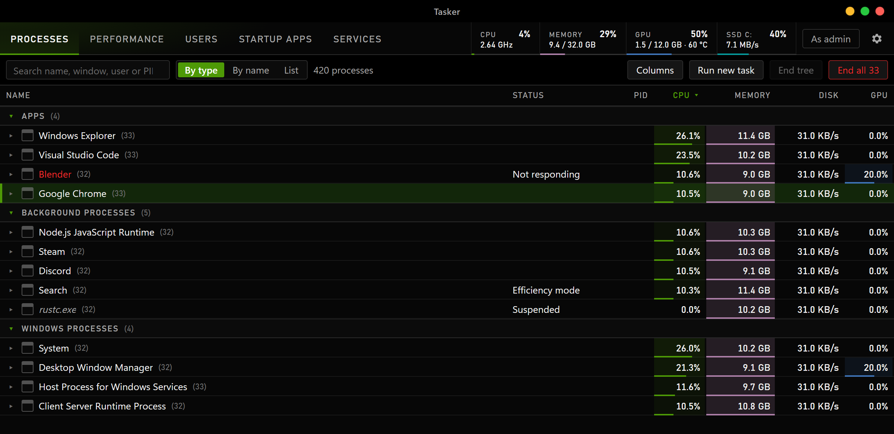
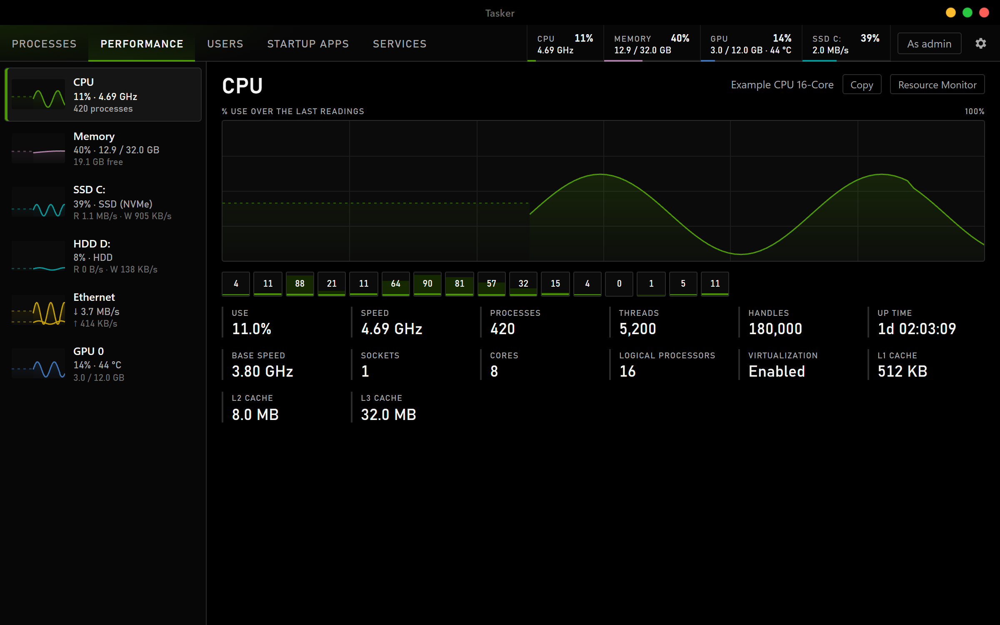
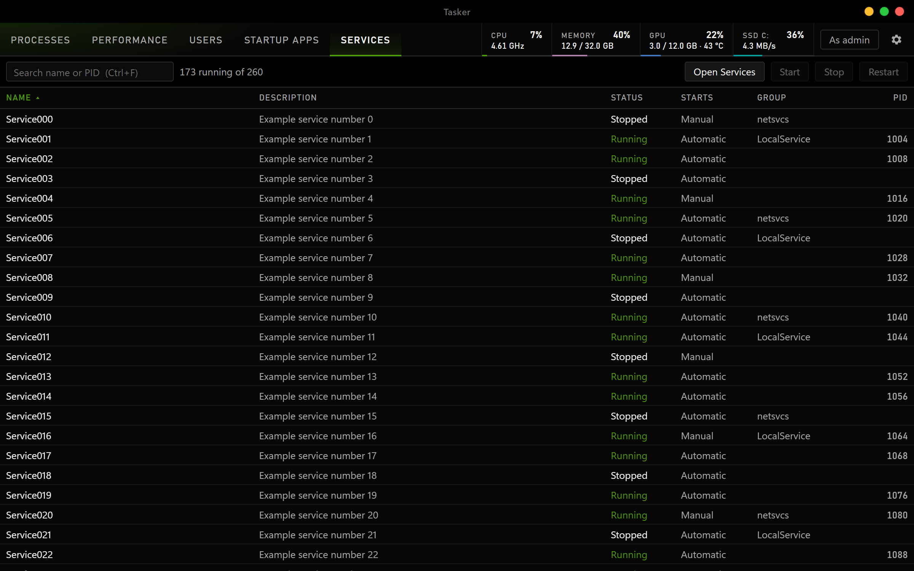
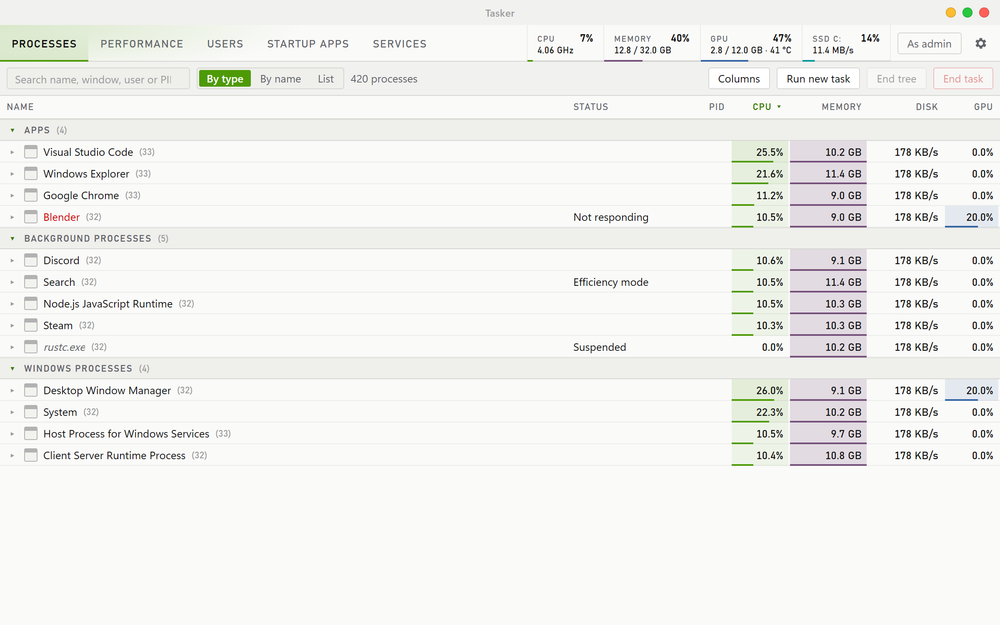

<p align="center">
  
</p>

<h1 align="center">Tasker</h1>

<p align="center">
  A task manager for Windows that stays light and does not lag.<br>
  What Windows Task Manager does, plus a few things it does not, in a 1.6 MB installer.
</p>

<p align="center">
  
</p>

<p align="center"><sub>The pictures on this page show made-up sample data.</sub></p>

## Why

A task manager is the tool you open when the PC is already struggling, so it should cost next to
nothing itself. Tasker is built for that: a small Rust backend reads the system, and the screen is
plain TypeScript with no framework that only draws the rows in view. One background thread takes
the readings, and it reads only what the visible tab needs; hidden in the tray it reads almost
nothing.

Measured on the same PC over 30 seconds, both windows open on the process list:

| | Tasker | Windows Task Manager |
| --- | --- | --- |
| CPU while showing | **0.14 %** | 0.53 – 0.55 % |
| CPU while minimised | **0.04 %** | not measured |
| Memory (private) | 263 MB in 7 processes | **126 MB** |

The memory line is the honest price of the approach: the window is drawn by WebView2, the browser
engine that ships with Windows, and that is where the memory goes.

## What it does

**Processes**
- Grouped the way Windows does it (apps, background processes, Windows processes), one row per
  program, or a flat list of every process. Sorting and search (`Ctrl+F`) by name, window, user or
  PID.
- 22 columns to choose from besides the name: status, PID, user, CPU, memory, disk, GPU, threads,
  handles, CPU time, priority, session, start time, architecture, elevated, working set, commit
  size, type, description, publisher, path and command line. The chosen columns and their widths
  are remembered.
- Every program that has an icon shows it. Busy cells get warmer as the load rises.
- Right-click: end task, end process tree, switch to, suspend / resume, efficiency mode, set
  priority, set affinity, details, go to services, create dump file, open file location,
  properties, search online, copy name / PID / path / command line, restart Windows Explorer.
- Run a new task (`Ctrl+N`), also as administrator.

**Performance**
- CPU (also per core), memory, every disk, every network adapter, GPU.
- Graphs drawn on a plain canvas with no chart library, and the real values beside the
  percentages: GB used of GB total, MB/s, °C.
- Four live meters stay in the top bar on every tab.

**Users, Startup apps, Services**
- Who is signed in and what their programs use together; disconnect or sign off a session.
- Startup entries from the registry, the startup folders and Store apps, with the same on/off
  switch Windows uses and where each entry is set.
- Services with their state, start, stop and restart, and a jump from a process to its services.

**The app itself**
- `Ctrl+Shift+Esc` opens Tasker instead of Windows Task Manager. It needs no administrator rights
  and changes nothing in Windows: switch it off in settings or quit Tasker, and the key is
  Windows' again.
- Lives in the tray. An extra shortcut of your choice can show or hide it.
- Light and dark, or follows Windows. Its own title bar. Remembers its size and place.
- Settings: refresh speed (or paused, `F5` refreshes once), the tab it opens on, always on top,
  close to tray, minimise to tray, start with Windows.

<p align="center">
  
</p>

<p align="center">
  
  
</p>

## Keys

| Key | What it does |
| --- | --- |
| `Ctrl+Shift+Esc` | Show or hide Tasker, from anywhere |
| `Ctrl+1` … `Ctrl+5` | Switch tab |
| `Ctrl+F` | Search the current list |
| `Ctrl+N` | Run new task |
| `F5` | Refresh now |
| `Del` | End the selected task |
| `Enter` | Details of the selected process |
| `Esc` | Close a menu, clear the search |

## Build it

You need Windows 10 or 11, a current [Node.js](https://nodejs.org) LTS and
[Rust](https://rustup.rs) (stable, MSVC toolchain).

```powershell
git clone https://github.com/fizzexual/tasker.git
cd tasker
npm install
npm run tauri build
```

The build writes two files:

- `src-tauri\target\release\Tasker.exe`, the program itself
- `src-tauri\target\release\bundle\nsis\Tasker_1.0.0_x64-setup.exe`, the installer. It installs
  for the current user only and asks for no administrator rights.

## Work on it

```powershell
npm run tauri dev                # the real app, reloading as you edit
npm run dev                      # only the screen, in a browser, on made-up data
npm test                         # screen tests (Vitest)
npm run typecheck                # TypeScript
cd src-tauri; cargo test --lib   # backend tests
```

`npm run dev` is the quick way to work on the look: opened in a normal browser at
`http://localhost:1420`, the screen runs on invented processes, so nothing has to be built.

```
src/                 the screen: plain TypeScript, one stylesheet, no framework
  processes.ts         process list (virtual list in vlist.ts, columns in columns.ts)
  performance.ts       graphs (chart.ts) and readouts (readout.ts)
  users.ts  startup.ts  services.ts  settings.ts  titlebar.ts
  api.ts               every backend call in one typed place
  mock.ts              made-up data for the browser, never shipped
src-tauri/src/       the backend: Rust
  proclist.rs  procinfo.rs  procs.rs  ntproc.rs  tree.rs  wins.rs    reading processes
  sampler.rs           one thread that reads only what the visible tab needs
  pdh.rs  hardware.rs  disk, network and GPU counters; what the machine is made of
  actions.rs  elevate.rs  startup.rs  services.rs  users.rs          doing things
  keyhook.rs           Ctrl+Shift+Esc
  icons.rs             program icons
  winframe.rs          keeps an auto-hidden taskbar reachable under a maximised window
  lib.rs               window, tray, single instance, commands
tests/               screen tests
tools/make-logo.py   draws the logo and writes every icon size
```

## Good to know

- **Windows only.** It talks to Windows directly; there is no macOS or Linux version.
- **Administrator windows.** While a program running as administrator is in front, Windows does
  not show key presses to normal programs, so `Ctrl+Shift+Esc` opens Windows Task Manager there.
  Settings has "Restart as administrator" for that, which also allows actions on protected
  processes.
- **Memory.** Higher than Windows Task Manager, see the table above.
- **No download yet.** There is no published installer; build it with the four commands above.

## License

No license has been chosen yet, so for now all rights are reserved.
